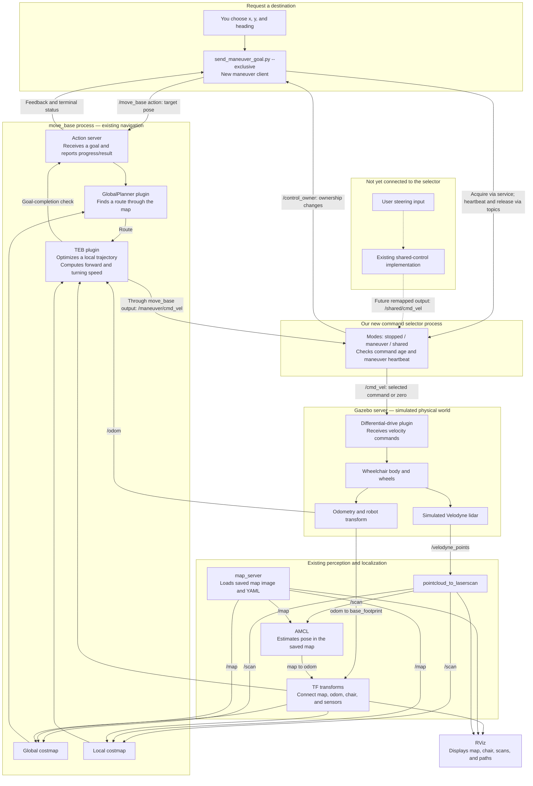
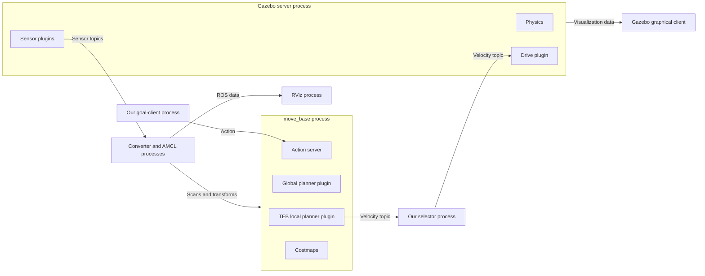
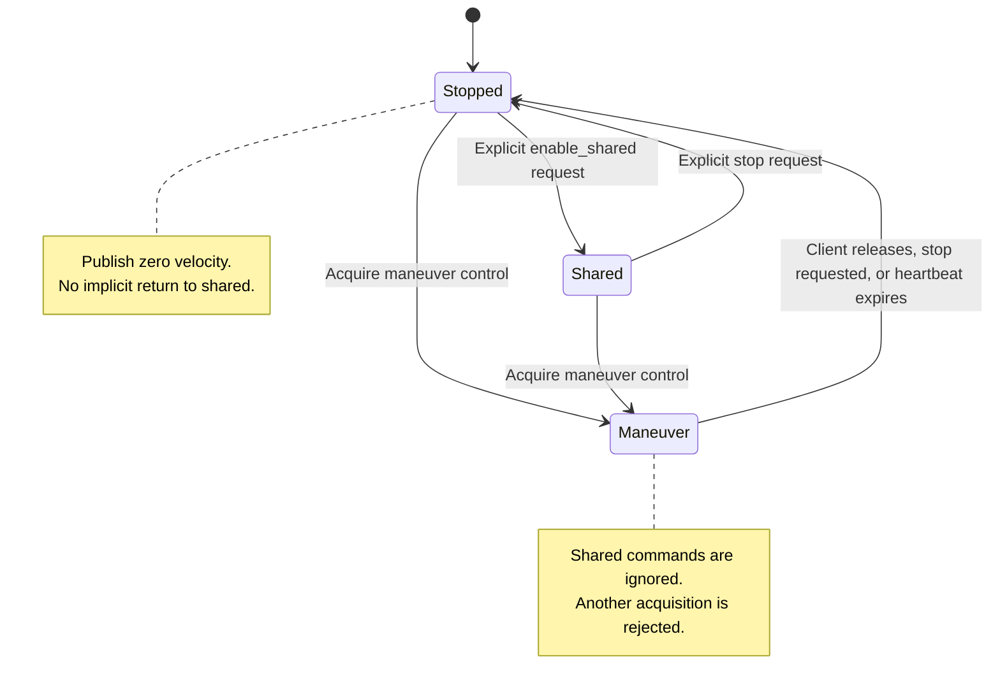
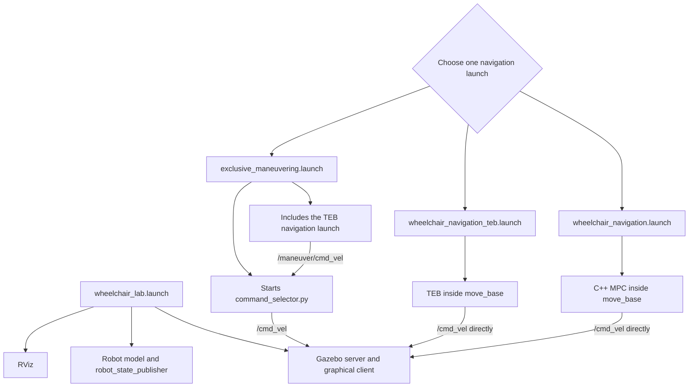
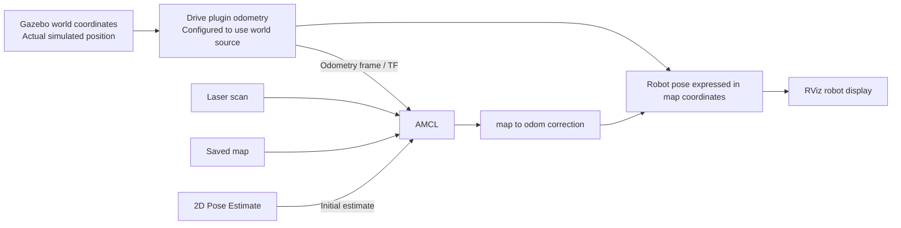
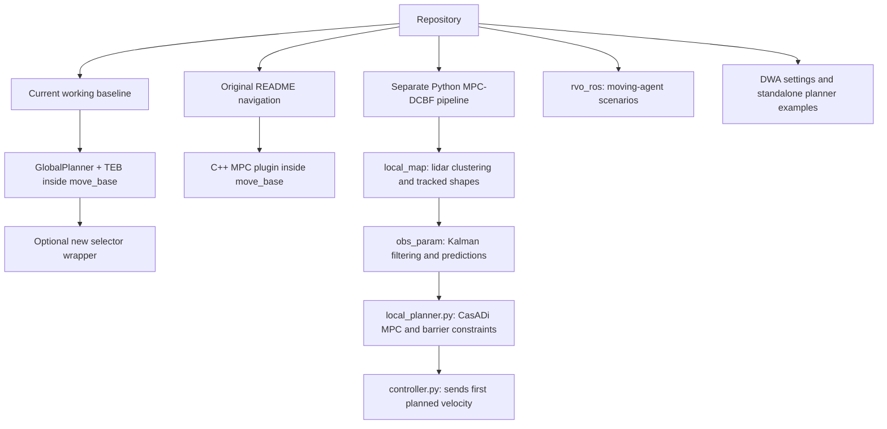
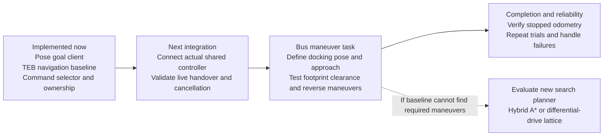

# Wheelchair simulation and maneuvering architecture

Read sections 1–4 first. They explain the setup we are working toward using the
new **exclusive maneuvering launch**. Later sections explain the other controllers
in the repository and where future docking work belongs.

Diagrams use Mermaid. View this file in a Markdown viewer with Mermaid support
(for example, GitHub). Tables and text explain the same connections if the
diagrams do not render in your editor.

## 1. Five jobs, five different components

| Question | Component responsible |
|---|---|
| Where is the chair? | AMCL localization, odometry, and TF |
| Which route should it take? | Global planner inside `move_base` |
| What speed and turn command should it use now? | TEB local planner inside `move_base` |
| Who is allowed to drive? | Our new command selector |
| What does the chair actually do? | Gazebo physics and the differential-drive plugin |

Our goal-sending script requests a destination. It does not calculate the route
or steering. RViz displays the system and lets you send goals; it does not
simulate the chair. The selector chooses a command source; it does not blend
commands or decide how to turn.

## 2. The big picture: exclusive maneuvering setup

**Solid arrows are implemented connections. Dashed arrows show a shared-control
connection that still needs integration.** A topic name on an arrow identifies
the ROS channel carrying that data.



**The loop:** navigation commands motion → Gazebo moves the chair → sensors and
odometry change → navigation calculates the next command.

The selector should be the **only publisher on `/cmd_vel`** in this setup.
This is enforced by launch configuration, not by ROS permissions. A node that
still publishes directly to `/cmd_vel` can bypass it.

## 3. What runs where

ROS nodes are programs. Plugins are libraries inside a program. Topics carry
streams of messages. Services handle requests and replies. Actions handle tasks
that take time, including feedback, completion, and cancellation.



Closing Gazebo's **graphical client** can reduce CPU use while its server keeps
simulating. Stopping the simulation launch stops the server too.

TEB is not a separate executable in this setup. `move_base` loads its plugin.
Our maneuver script is an **action client**, not a new action server.

## 4. What happens when you run an exclusive goal

```mermaid
sequenceDiagram
    actor User
    participant Client as send_maneuver_goal.py
    participant Selector as command_selector.py
    participant Nav as move_base + TEB
    participant Chair as Gazebo wheelchair

    Note over Selector,Chair: Selector starts stopped and publishes zero
    User->>Client: Run with x, y, yaw, and --exclusive
    Client->>Nav: Wait for navigation action server
    Client->>Selector: /control/enable_maneuver, data=true
    Selector-->>Client: Unique ownership token, or rejection if busy
    Note over Selector: Clear old commands; zero during 0.25 s handover
    Client->>Nav: Send map-frame target pose
    loop While navigation is active
        Client->>Selector: Heartbeat carrying ownership token
        Nav->>Selector: /maneuver/cmd_vel
        Selector->>Chair: /cmd_vel, if selected and fresh
        Chair-->>Nav: Odometry and sensor feedback
    end
    Nav-->>Client: Terminal result, e.g. status 3
    Client->>Selector: Release ownership token
    Selector->>Chair: Zero velocity; mode becomes stopped
    Note over Client,Chair: Physical stopped motion is not independently verified yet
```

Pressing Ctrl+C requests cancellation of this client's navigation goal and
releases control. If its heartbeat disappears, the selector changes to stopped
after two wall-clock seconds. It does not automatically return to shared control.

Sending another RViz goal can replace the action client's navigation goal.
The selector controls velocity sources, not which client may send navigation
goals. Avoid using RViz's goal tool during a scripted maneuver.

## 5. Command selector modes



| Mode | Accepted input | Output when input is absent/stale |
|---|---|---|
| `stopped` | Neither source | Zero |
| `shared` | `/shared/cmd_vel` | Zero |
| `maneuver` | `/maneuver/cmd_vel` | Zero |

Important implementation details:

- A transition clears stored commands and outputs zero for 0.25 seconds.
- Selected velocity commands expire after two wall-clock seconds. A command
  timeout outputs zero but does not itself change mode.
- A maneuver heartbeat timeout changes mode to stopped.
- The token identifies the maneuver client. Older tokens cannot renew or release
  a newer client's ownership.
- `/control/enable_maneuver` with `data: false` is an explicit stop request.
- `/control/enable_shared` is rejected while maneuver mode is active.
- A shared controller has not yet been connected. Enabling shared mode alone
  does not create one.

The selector does not check obstacles, goal error, or wheel motion. Its process
must remain alive to publish zero; a real deployment also needs a downstream
motor command watchdog. Token handling is coordination, not security.

## 6. Which launch should I use?

Start the simulation once, then choose **one** navigation setup.



| Navigation launch | Controller | Selector? | Goal script flag |
|---|---|---|---|
| `wheelchair_navigation.launch` | C++ MPC | No | No `--exclusive` |
| `wheelchair_navigation_teb.launch` | TEB | No | No `--exclusive` |
| `exclusive_maneuvering.launch` | TEB | Yes | Use `--exclusive` |

The ordinary TEB launch was used for the successful navigation experiments.
The exclusive setup adds ownership around that controller. Its gate logic and
launch remapping were checked; live mode switching still needs validation.

The include chain for the exclusive setup is:

```text
wheelchair_maneuvering/launch/exclusive_maneuvering.launch
  ├─ scoped remap: /cmd_vel → /maneuver/cmd_vel
  │  └─ wheelchair_navigation/launch/wheelchair_navigation_teb.launch
  │     └─ wheelchair_navigation/launch/wheelchair_navigation.launch
  │        ├─ pointcloud_to_laserscan
  │        ├─ map_server
  │        ├─ amcl.launch
  │        └─ move_base_teb.launch (selected through a launch argument)
  └─ command_selector.py (outside the remap scope)
```

The original `wheelchair_navigation.launch` still defaults to `move_base.launch`
and C++ MPC. Its `move_base_launch` argument allows the TEB wrapper to substitute
the controller launch without duplicating the sensor/localization setup.

## 7. Position: Gazebo truth versus RViz's estimate



RViz's **2D Pose Estimate changes localization**, not the physical chair. A
**2D Nav Goal requests physical motion** through navigation.

The intended TF tree is:

```text
map                         AMCL supplies map → odom
 └─ odom                    Drive plugin supplies odom → base_footprint
     └─ base_footprint
         └─ base_link        Robot model supplies body/sensor transforms
             ├─ velodyne
             ├─ imu_link
             └─ camera frames
```

The saved map and Gazebo world are not assumed to have identical coordinates.
The recorded lab map initialization is approximately `(5.151, 6.447, 3.139 rad)`.
It is a reusable initial estimate for the original spawn, not a calibrated
world-to-map transform. If you restart navigation after moving the chair, that
old estimate may be wrong. Check that laser points follow the mapped walls.

## 8. The other planning systems in this repository

These are alternatives, not additional stages required by the current TEB setup.



The Python MPC-DCBF flow is:

```text
/velodyne_points
  → local_map_pub
  → /local_map_pub/for_obs_track
  → obs_kf
  → /obs_predict_pub
  → local_planner.py, also using global path and /curr_state
  → /local_plan
  → controller.py
  → /cmd_vel in its original configuration
```

That controller also publishes `/curr_state` from TF. The Python planner has
user-input blending; the C++ MPC plugin also subscribes to user commands.
Neither is currently wired into `/shared/cmd_vel`. Integration must address both
command output remapping and whether user input is blended before commands reach
the selector. The exclusive setup uses TEB, which does not use that blending.

Do not start the old MPC-DCBF launch alongside the exclusive setup: its original
command publishers can bypass the selector and duplicate navigation components.

## 9. Repository map: where to read or change things

Paths below are relative to the repository root.

| Job | File or directory |
|---|---|
| Send a destination and handle its result | [send_maneuver_goal.py](../wheelchair_maneuvering/scripts/send_maneuver_goal.py) |
| Choose command ownership and handle timeouts | [command_selector.py](../wheelchair_maneuvering/scripts/command_selector.py) |
| Connect exclusive navigation and selector | [exclusive_maneuvering.launch](../wheelchair_maneuvering/launch/exclusive_maneuvering.launch) |
| TEB baseline settings and overrides | [move_base_teb.launch](../wheelchair/wheelchair_navigation/launch/move_base_teb.launch) |
| Original TEB parameter set | [teb_local_planner_params.yaml](../wheelchair/wheelchair_navigation/params/teb_planner_params/diff_drive/teb_local_planner_params.yaml) |
| Shared sensor, map, and localization setup | [wheelchair_navigation.launch](../wheelchair/wheelchair_navigation/launch/wheelchair_navigation.launch) |
| AMCL settings | [amcl.launch](../wheelchair/wheelchair_navigation/launch/amcl.launch) |
| Current baseline costmap configuration | [params/mpc_params](../wheelchair/wheelchair_navigation/params/mpc_params) — reused by TEB despite its directory name |
| Spawn lab simulation | [wheelchair_lab.launch](../wheelchair/wheelchair_gazebo/launch/wheelchair_lab.launch) |
| Wheelchair geometry and Velodyne | [wheelchair_1.urdf.xacro](../wheelchair/wheelchair_description/urdf/wheelchair_1.urdf.xacro) |
| Drive plugin and other sensor configuration | [wheelchair.gazebo.xacro](../wheelchair/wheelchair_description/urdf/wheelchair.gazebo.xacro) |
| Bus simulation entry point | [wheelchair_bus.launch](../wheelchair/wheelchair_gazebo/launch/wheelchair_bus.launch) |
| Saved maps | [maps](../wheelchair/wheelchair_navigation/maps) |
| C++ MPC ROS wrapper | [mpc_plannner_ros.cpp](../move_base_planner/mpc-ros/mpc_ros/src/mpc_plannner_ros.cpp) |
| Python MPC-DCBF planner | [local_planner.py](../MPC-D-CBF/local_planner/scripts/local_planner.py) |
| Moving agents | [rvo_ros](../rvo_ros) |

The bus launch currently uses a different robot Xacro from the lab launch.
Verify its sensor topics and matching map before reusing lab navigation.

## 10. Small ROS interface reference

| Interface | Kind | Meaning |
|---|---|---|
| `/move_base` | Action | Request navigation, receive feedback/result, cancel |
| `/move_base_simple/goal` | Pose topic | RViz's simpler navigation-goal input |
| `/move_base/status` | Status topic | `1`: active; `3`: succeeded; `2`: preempted |
| `/maneuver/cmd_vel` | Twist topic | Autonomous navigation output before selection |
| `/shared/cmd_vel` | Twist topic | Reserved connection for the shared controller |
| `/cmd_vel` | Twist topic | Final command consumed by the simulated drive |
| `/control/enable_maneuver` | SetBool service | `true`: acquire; `false`: stop |
| `/control/enable_shared` | Trigger service | Explicitly select shared mode if no maneuver owns it |
| `/maneuver/heartbeat` | String topic | Renew current owner's token |
| `/maneuver/release` | String topic | Release current owner's token |
| `/control_mode` | String topic | Current selector mode |
| `/control_owner` | String topic | Current token, or empty when unowned |
| `/scan` | LaserScan topic | Measured obstacle surfaces |
| `/map` | OccupancyGrid topic | Saved environment map |
| `/amcl_pose` | Pose with covariance topic | Localization estimate; not published every control cycle |
| `/odom` | Odometry topic | Robot odometry and measured velocity |
| `/tf`, `/tf_static` | Transform topics | Coordinate relationships |

For `Twist`, `linear.x` is forward speed in metres/second and `angular.z` is
turning speed in radians/second. The script accepts heading in **degrees**, then
converts it into a quaternion. Heading is absolute in `map`, not a relative turn.

## 11. What exists now and what maneuvering still needs



A custom planner would supply a feasible route or maneuver trajectory. It would
not replace localization, command ownership, or the need to track and stop.
Any custom trajectory interface must preserve heading and forward/reverse intent.

Current limits to remember:

- A `status 3` result is navigation's success report. The client does not yet
  independently verify stable stopped odometry before completing.
- Three consecutive stable stops supported the TEB tuning change in the lab;
  they do not establish reliability for all bus docking situations.
- The selector is implemented, but real shared-controller handover remains to
  be integrated and tested.
- This is simulated navigation to a supplied pose. Automatic bus-space detection
  and a dedicated multi-stage docking procedure are not implemented.

## 12. Minimal operating checklist

Terminal 1 — simulation:

```bash
source ~/catkin_ws/devel/setup.bash
roslaunch wheelchair_gazebo wheelchair_lab.launch
```

Terminal 2 — exclusive navigation (replace any other navigation launch):

```bash
source ~/catkin_ws/devel/setup.bash
roslaunch wheelchair_maneuvering exclusive_maneuvering.launch
```

Check localization, then terminal 3 — choose an appropriate clear target:

```bash
source ~/catkin_ws/devel/setup.bash
rostopic info /cmd_vel
# Only /command_selector should publish here.
rosrun wheelchair_maneuvering send_maneuver_goal.py \
  --x 2.767 --y 6.261 --yaw-deg 0 --exclusive
```

The example coordinates came from a lab trial; select a suitable destination
for your current scene. Ctrl+C in the goal-client terminal requests cancellation.
To explicitly select stopped mode from another terminal:

```bash
rosservice call /control/enable_maneuver "data: false"
```

For more startup help, see [GETTING_STARTED.md](GETTING_STARTED.md). For details
on the new package, see [its README](../wheelchair_maneuvering/README.md).
